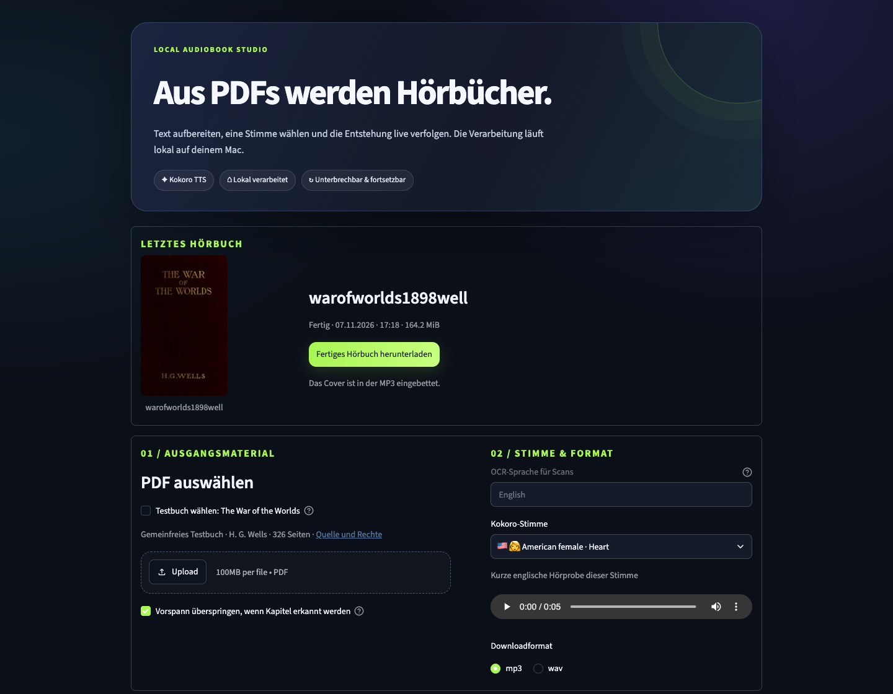
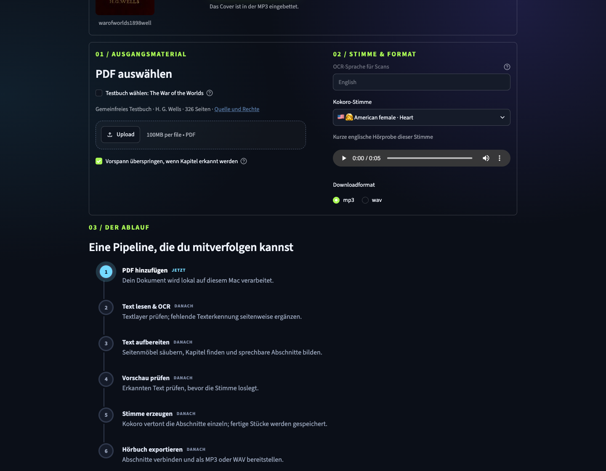
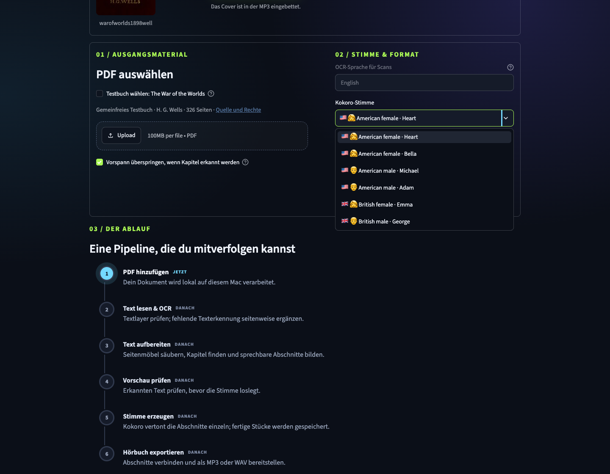
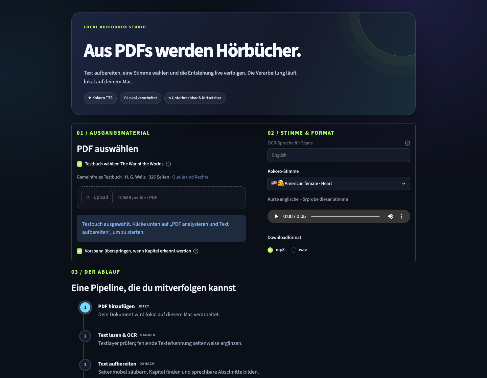
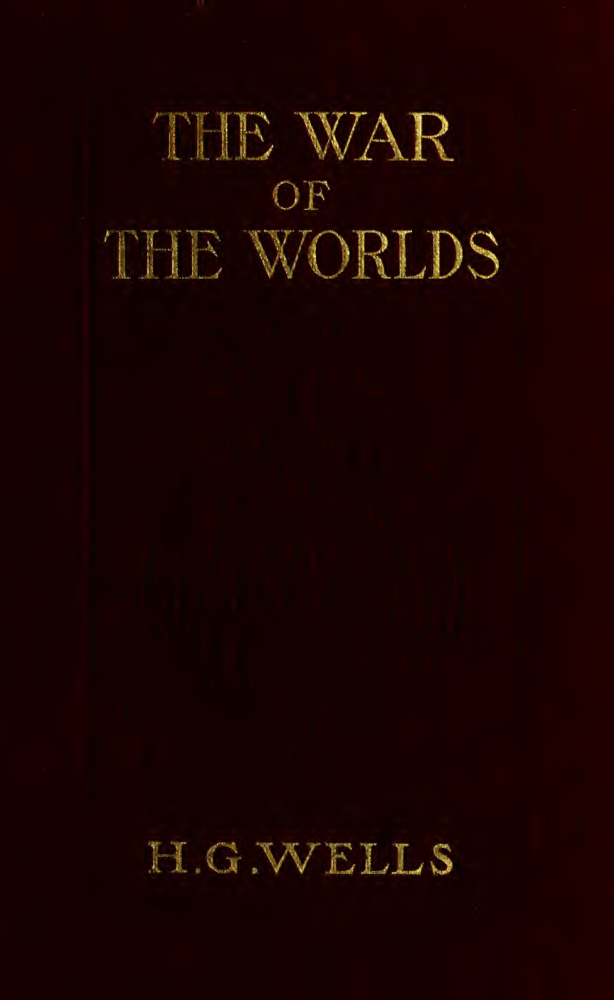

<div align="center">

# Kokoro PDF to Audiobook

### Turn a PDF into a locally generated audiobook on your Apple Silicon Mac.

**OCR when needed · Reviewable text · Kokoro voices · MP3 or WAV**

[](LICENSE)


[Get started](#-get-started) · [How it works](#-from-pdf-to-audio) · [Try the sample book](#-try-the-included-sample) · [Project details](#-project-details)

</div>

---

## Your PDF, ready to listen

Choose a PDF, listen to the built-in voice samples, review the prepared text, then create an audiobook. Scanned pages can go through English OCR. The app runs on your Mac and offers an MP3 or WAV download.

> **Prototype status:** preprocessing has been validated on the included public-domain scan. A full audiobook file was generated, but the entire book has not been listened through. See [validation details](validation.md).

## Screenshots

Here is the running app, followed by the processing timeline, voice selector,
and the public-domain test book included in the repository.



| The six-stage pipeline | Built-in sample voices |
|---|---|
|  |  |

| Select the included test book | Its cover, rendered from the sample PDF |
|---|---|
|  |  |

## ✨ What it does

| | |
|---|---|
| **Reads PDFs** | Extracts selectable text and uses OCR for image-only pages without usable text. |
| **Prepares the text** | Cleans common scan artifacts, joins wrapped lines, repairs stray asterisks and splits prose into speech-sized chunks. |
| **Lets you review first** | Inspect the prepared text and preview English voices before synthesis. |
| **Resumes interrupted work** | Reuses completed page extraction and audio chunks when you restart the same job. |
| **Exports a ready-to-download book** | Saves MP3 or WAV. The PDF's first page is displayed as the cover and embedded with the filename-based title in MP3 metadata. WAV includes a separate cover download. |

Everything after model and dependency setup runs locally on your Mac. The first setup downloads packages and the Kokoro model.

## 🚀 Get started

**Requirements:** macOS on Apple Silicon, Python 3.11 and internet access for first-time setup.

```bash
git clone https://github.com/outspokende/kokoro-pdf-audiobook.git
cd kokoro-pdf-audiobook
./install.sh
./start.sh
```

Open **http://localhost:8501** on your Mac.

### Scanned PDFs

Install Tesseract once if your PDF contains scanned pages without a usable text layer:

```bash
brew install tesseract tesseract-lang
```

OCR is English-only to match the built-in Kokoro voices. Always review OCR text before generating audio.

### Reach it from your LAN or VPN

The app listens on all network interfaces by default. Open `http://<your-Mac-IP>:8501` from a device on your trusted LAN or VPN. To restrict access to the Mac, start it with:

```bash
APP_HOST=127.0.0.1 ./start.sh
```

This is a local app, not a public upload service. Do not expose it to an untrusted network.

## 🧭 From PDF to audio

```text
PDF → PyMuPDF text extraction → Tesseract OCR when needed
    → text cleanup and chapter preparation → review
    → Kokoro via MLX Audio → WAV / MP3 download
```

The interface shows a live six-stage timeline for upload, OCR, preparation, review, synthesis and export. Page and audio checkpoints support resume after an interruption.

## 📖 Try the included sample

Select **“Testbuch wählen: The War of the Worlds”** in the app to use the included 326-page public-domain scan. Review the prepared text before creating audio. A complete book can take a long time to synthesize.

The sample's source and public-domain status are documented in [`samples/war-of-the-worlds/README.md`](samples/war-of-the-worlds/README.md).

## 🔒 Privacy and rights

PDFs and generated audio stay on the Mac during processing. Do not process confidential PDFs or books you do not have permission to use. This project does not bypass DRM and does not clone voices.

The project is licensed under AGPL-3.0. PyMuPDF is offered under AGPL or a commercial license. This project uses the AGPL option. The Kokoro MLX model card lists Apache-2.0. Review the relevant terms before redistributing modified versions or using generated audio commercially.

## 🧪 Current validation

The 326-page fixture produced 22 chapters and 1,110 speech chunks. Preprocessing correctly bounded the narrative from its first chapter to “THE END.” OCR, resumable chunk synthesis, MP3 encoding, title metadata and embedded cover art were checked. Full-length listening and complete audiobook playback quality have not been independently reviewed.

See the detailed [validation record](validation.md).

## 🗂️ Project details

- [Architecture and local data flow](architecture.md)
- [Components and dependencies](inventory.md)
- [Validation record and limitations](validation.md)
- [Project backlog](backlog.md)
- [AI-assisted installation prompt](INSTALL_WITH_AI.md)
- [Included sample book and provenance](samples/war-of-the-worlds/README.md)

## 🙌 Contributions

Issues, bug reports and improvements are welcome. Before sharing a PDF or audio sample in an issue, make sure you have the right to share it and remove personal information.
